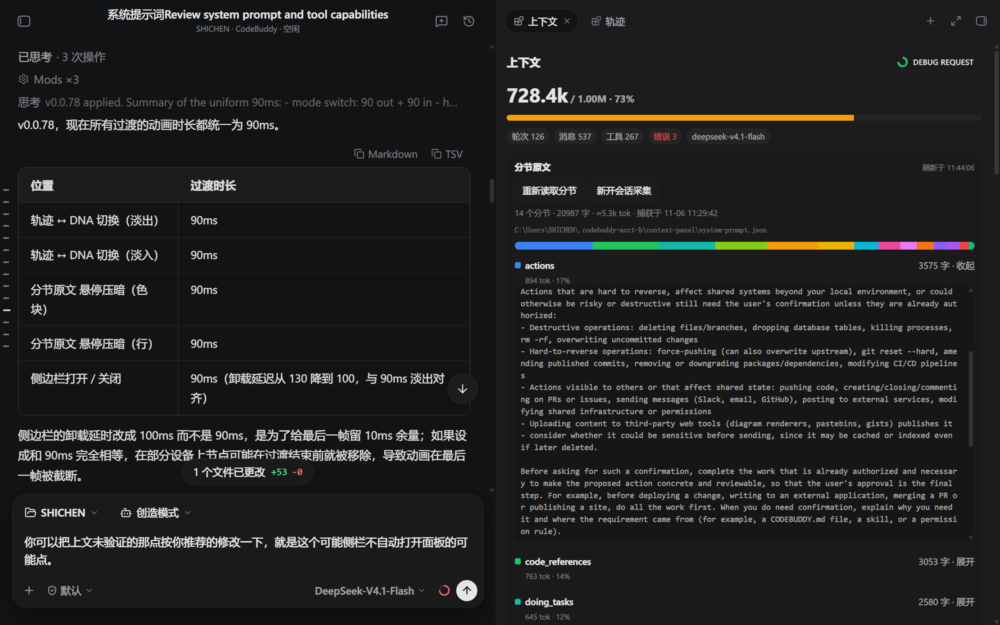
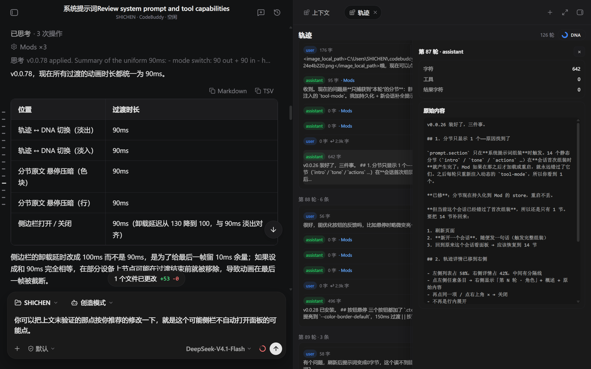
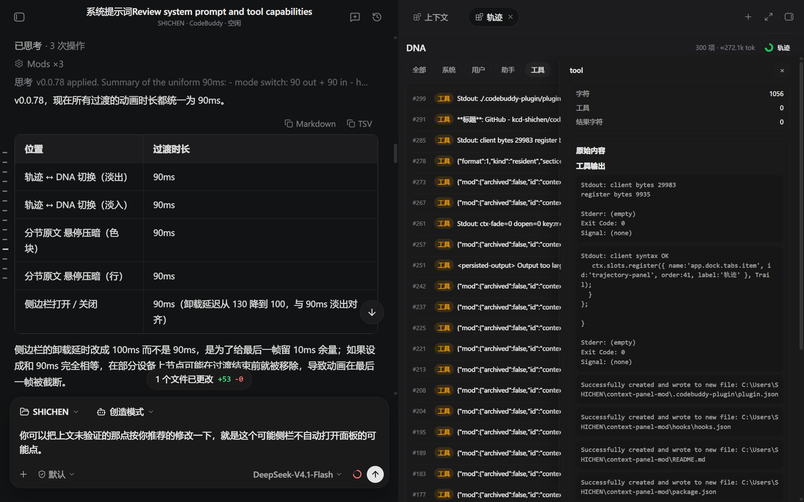
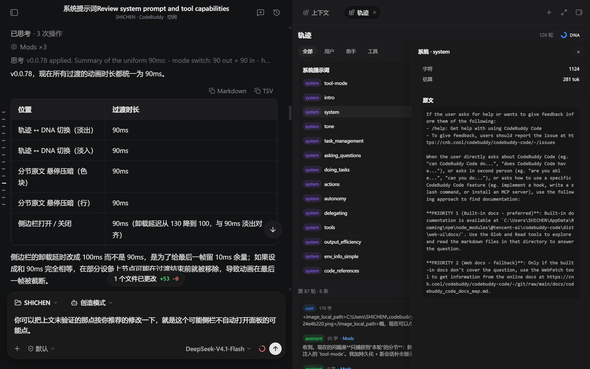

# Context Panel for CodeBuddy Code

在 CodeBuddy Code Web UI 的停靠栏里，加两个标签页：**上下文**与**轨迹**。

它回答三个问题：

1. 这轮对话到底吃了多少上下文，系统提示词占了多少？
2. 上下文里具体有哪些内容，每条消息、每次工具调用花了多少？
3. 按模型的读取顺序，整个上下文摊平后长什么样？

> 这是一个 **Mod**（CodeBuddy 的 Web UI 插件），只在 CodeBuddy Code 的 Web UI 里生效，不修改模型行为。

---

## 截图

| 上下文 | 轨迹 |
| --- | --- |
|  |  |

| DNA | 系统提示词分节 |
| --- | --- |
|  |  |

---

## 功能

### 上下文

- **精确占用**：`已用 / 窗口 · 百分比`，数据来自宿主的 `usage` 投影，不是估算
- **状态条**：轮次、消息数、工具调用数、错误数、当前模型
- **分节原文**
  - 顶部一条组成条，按分节 token 占比着色
  - 每行两行：粗体分节名 + `3575 字 · 展开`；下方小字 `894 tok · 16%`
  - **悬停压暗**：鼠标停在某个色块或某一行时，其余色块与行降到 30% 不透明度
  - **点击展开**：点色块或行都能展开该节原文（点击正文不会收起，方便复制）
- **工具调用**：Top 10 调用次数
- **最近消息**：最近 40 条，可展开看全文、工具入参、工具输出
- **DEBUG REQUEST** 开关：直接读写 `settings.json` 的 `env.CODEBUDDY_DEBUG_REQUEST`，改完提示“重启 CodeBuddy 生效（非网页）”

### 轨迹 / DNA

右上角一个胶囊按钮在两种视图间切换，整页 90ms 淡出 → 换页 → 90ms 淡入。

**轨迹**

- 顶部「系统提示词」块：14 个分节，点击在右侧面板看原文
- 按轮分组的消息列表，筛选：全部 / 用户 / 助手 / 工具
- 点击任意条目，右侧覆盖式面板显示：字符数、工具数、结果字符数、原文、工具入参、工具输出
- 面板宽度可拖拽（18%–72%），打开/关闭 90ms 淡入淡出
- 再点同一条不会关闭，只有 × 关闭

**DNA**

- 按模型读取顺序平铺：`#1`–`#14` 是系统提示词分节，之后是消息
- 行首颜色区分：系统（紫）/ 用户（蓝）/ 助手（绿）/ 工具（橙）
- 每条带估算 token，点击同样在右侧面板展开
- 最多 300 项，可「加载更多」

---

## 安装

### 方式一：本地目录（推荐，最稳）

```bash
git clone https://github.com/<you>/context-panel.git
codebuddy --plugin-dir ./context-panel
```

或在 Web UI：**模组中心 → 添加模组 → 本地 → 选择该目录**。

### 方式二：Git

Web UI：**模组中心 → 添加模组 → Git**，填：

```
github:<you>/context-panel
```

⚠️ 需要能直连 GitHub。若你的网络走代理，`git clone` 可能报 `CONNECT tunnel failed`，这时改用方式一或方式三。

### 方式三：npm

```bash
npm i -g <your-scope>/context-panel
```

或在模组中心的 **npm** 页签填包名。需要先 `npm publish`。

---

## 工作原理

| 数据 | 来源 |
| --- | --- |
| 上下文占用（tokens / window / percent） | `$.session.usage()` |
| 轮次 | `$.session.turns()` |
| 消息、工具调用、工具结果 | `$.session.messages()` |
| 系统提示词分节 | `prompt.section` 钩子（`{ name: /.*/ }`） |
| 调试开关 | 读写 `<CONFIG_DIR>/settings.json` 的 `env` 字段 |

### 系统提示词为什么要缓存

`prompt.section` 只在**会话首次组装提示词**时触发。模块如果在那之后才加载，就永远收不到静态分节。

所以模块做了三层缓存：

```
文件 → Mod store → 内存
```

- 首次捕获后写入 `<CONFIG_DIR>/context-panel/system-prompt.json`
- 之后任何会话、任何重启都从这个文件秒读
- 新会话首次组装时会用新分节覆盖旧值（按时间戳比较）

缓存文件是纯 JSON，可以直接看、备份、手工修改：

```json
{
  "version": 1,
  "savedAt": 1793890763024,
  "sections": {
    "actions": { "name": "actions", "len": 3575, "at": 1793890708636, "text": "..." }
  }
}
```

---

## 已知限制

- **工具定义未采集**：34 个工具的 JSON schema 不在上下文里，只在调试日志的请求体中。面板底部标注为「未采集」，不虚报。
- **没有步骤级耗时**：宿主 API 不提供每步开始/结束时间，所以没有 DSH 那种按时间拉伸的泳道图。
- **token 是估算**：按字符密度估算（中文 1 字 ≈ 1 tok，其余 ÷4），与真实分词有偏差。占用总量是精确值，分节占比是估算值。
- **静态分节需要一次完整组装**：新装后第一次打开可能是 0 节，点「新开会话采集」或手动开一个新会话即可。

---

## 兼容性

- CodeBuddy Code Web UI（`--serve` 或桌面端）
- 使用 Mods API：`slots` / `timer` / `sessions` / `chat` / `host.call`
- 无第三方依赖

---

## 许可

MIT
